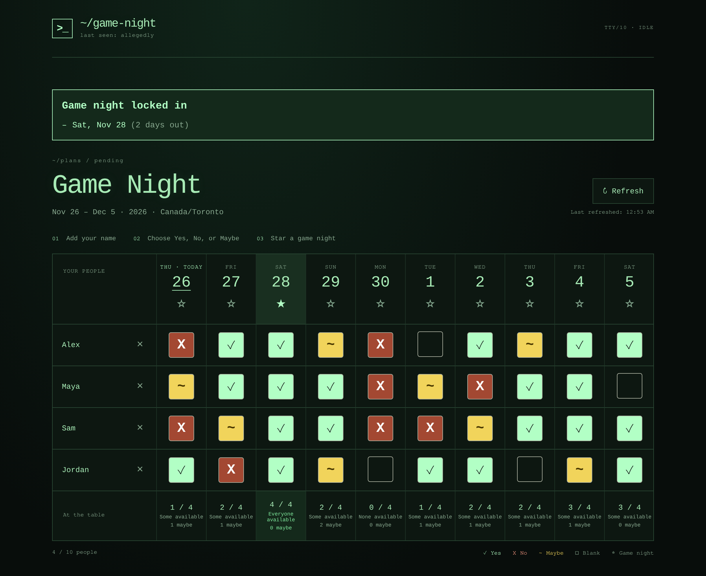
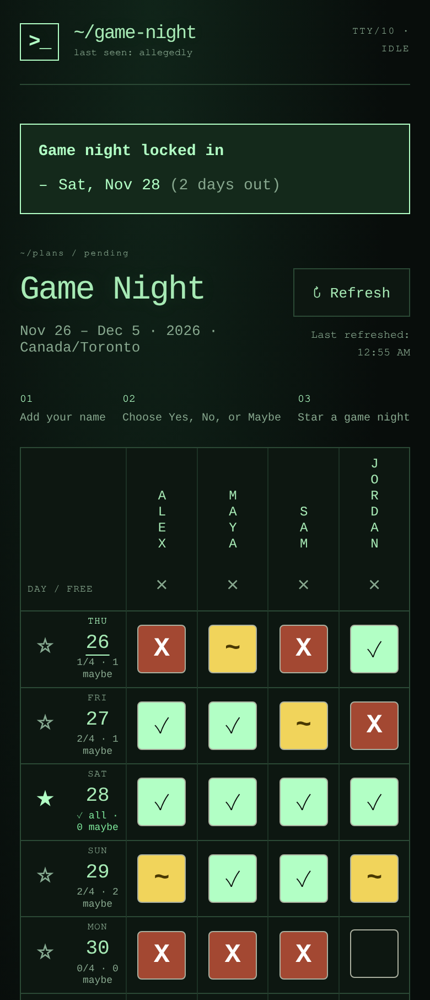

# Game Night

Ten days, ten friends, one table. A small shared availability calendar made with static HTML/CSS/JavaScript, Cloudflare Pages Functions, and D1. Open a private room link, add a name, choose Yes, No, Maybe, or Blank for each day, and star one or more game nights. Everyone with the link can edit every row.

The room's timezone determines today. Each edit saves immediately. **Refresh** loads other people's changes; there is no polling. The design uses a dark terminal palette, green monospace text, and understated phosphor accents. On phones, dates run down the calendar, participant names stack vertically across the top, and stars sit on the left. Date labels and name headers stay visible while scrolling a crowded room. Wider screens use participant rows and date columns.

| Desktop | Mobile |
| --- | --- |
|  |  |

## Local setup

Requires Node.js 22.13+ (Node 22 LTS recommended), npm, and an environment that permits Wrangler to start a local server. No Cloudflare account is needed for local D1.

```bash
npm ci
npm run check
npm run migrate:local
npm run room:provision -- game-night --local
npm run dev
```

Open the URL printed by provisioning, normally `http://localhost:8788/#room=game-night&key=…`. Wrangler serves both `public/` and the API, and stores local D1 under ignored `.wrangler/`. The checked-in production database UUID is an identifier, not a credential. Wrangler still uses local D1 unless you explicitly select the remote target.

`room:provision` refuses an existing room. Recover access to a local room with:

```bash
npm run room:rotate -- game-night --local
npm run room:list -- --local
```

If you select a different dev port, pass its origin to provisioning or rotation: `--base-url http://localhost:8790`. Local state is independent of production; all D1 administration commands require an explicit target. Avoid `--remote` during local development.

For a read-only home/config directory, point Wrangler's logs into the project before running commands:

```bash
export WRANGLER_LOG_PATH="$PWD/.wrangler/logs"
export WRANGLER_REGISTRY_PATH="$PWD/.wrangler/registry"
export WRANGLER_SEND_METRICS=false
```

The browser retains the secret only in the shared URL and page memory. Only the optional selected participant ID is stored in localStorage. Do not paste a real room URL into issues, shell commands, screenshots, or public messages. Provisioning prints the secret once; save the link privately. Local browser history may retain it.

## Testing the ten-day response calendar locally

On the `ten-day-responses` branch, run the local setup above. Apply `npm run migrate:local` even if you already have a local room: migration 0002 preserves existing checked dates as Yes. Click a participant's date to choose green ✓ Yes, red X No, yellow ~ Maybe, or Blank to reset. Escape, Cancel, or clicking outside the picker leaves the response unchanged.

The summary counts Yes responses as available and lists Maybe separately. The room API retains `available` (Yes dates) and adds a `responses` date-to-status map. New writes use `status: "yes" | "no" | "maybe" | null`; omit `available` when sending `status`.

Use only `--local` commands for review. These changes require no deployment. Migration compatibility preserves existing data; older application code does not understand No/Maybe records, so keep this feature's review database separate from any older running application.

## Deploy through GitHub

Deployment is deliberately left to the operator. No Git remote, Cloudflare project, or production database is created by this repository.

1. Create a GitHub repository (or fork this one). Commit this project and its lockfile, create/push `main`, and set `main` as the default branch. Check `git status --ignored` first: `.wrangler/`, secrets, database files, dependencies, and environment files must remain ignored.
2. Authenticate Wrangler locally with `npx wrangler login --device` on a headless server (or `npx wrangler login` with a browser), or use a narrowly scoped Cloudflare API token in your environment. Never commit credentials.
3. Create production D1 **before the first Pages deployment**:

   ```bash
   npx wrangler d1 create wenbre-db
   ```

4. Replace only `database_id` in `wrangler.jsonc` with the returned UUID. Preserve binding `DB`, the database name, preview settings, and `migrations_dir`. The UUID is public configuration, not a secret. Commit and push the change.
5. Apply the checked-in migration explicitly:

   ```bash
   npm run migrate:production
   ```

   This command targets remote production D1. Pages deployments do **not** apply migrations. Future migrations must remain compatible with the currently deployed application; apply additive changes before code that needs them. Review/backup production data before destructive schema work.
6. In Cloudflare's dashboard choose **Workers & Pages → Create application → Pages → Connect to Git**. Authorize the current Cloudflare GitHub App for your repository. Choose the Git-integrated Pages project workflow (not Workers Builds or Direct Upload). Set:

   | Setting | Value |
   |---|---|
   | Production branch | `main` |
   | Framework preset | None |
   | Root directory | repository root |
   | Build command | `npm run build` |
   | Build output | `public` |
   | Node version | `22` (`NODE_VERSION` build variable) |

   `wrangler.jsonc` is the authoritative supported Pages configuration. It supplies compatibility date, the production D1 binding, API variable, and preview overrides. Do not create a second production binding in dashboard configuration. The validation build checks room configuration and the static boundary without bundling frontend assets. Pages compiles `functions/` itself.
7. Deploy and confirm Pages recognizes the Wrangler configuration and `DB` binding. Production pushes to `main` should now automatically deploy static files and Functions. Static assets invoke no Functions because `public/_routes.json` includes only `/api/*`.
8. Provision the deployed, whitelisted room:

   ```bash
   npm run room:provision -- game-night --production --base-url https://YOUR-PROJECT.pages.dev
   ```

   Share the generated link privately. The command checks the target database/schema and refuses to overwrite existing provisioning, including simultaneous attempts. Only a random 256-bit key's SHA-256 hash is sent to D1. Plaintext keys are never written to files by the scripts.
9. Complete the browser and deployment checks in [docs/verification.md](docs/verification.md). Validate HTTPS on the real hostname. Verify that no secrets have been committed.

Cloudflare references: [Pages Wrangler configuration](https://developers.cloudflare.com/pages/functions/wrangler-configuration/), [native Git integration](https://developers.cloudflare.com/pages/configuration/git-integration/), [Pages D1 bindings](https://developers.cloudflare.com/pages/functions/bindings/), and [D1 foreign key enforcement](https://developers.cloudflare.com/d1/sql-api/foreign-keys/).

## Preview safety

`env.preview` has `API_ENABLED=false` and **no D1 bindings**. Preview pages display a clear API-unavailable error and cannot read or mutate production data. Do not set a preview `DB` binding to production in the dashboard.

If previews later need working calendars, create a separate preview D1 database, replace the empty preview `d1_databases` array with its distinct binding/UUID, and set preview `API_ENABLED=true`. Update the preview validation rule deliberately, migrate the isolated database with `--env preview --remote`, and provision it separately. The provided admin commands intentionally support only local or production; do not use production commands to provision previews. No preview resources are necessary for version 1.

## Approve and manage rooms

Edit `config/rooms.json`, run `npm run check`, commit/push, and wait for deployment before provisioning a new room. IDs are unique lowercase ASCII slugs (up to 80 characters). Supply a nonempty display name and valid IANA timezone. The configuration is bundled only into Functions. It is never in `public/`.

Removing a whitelist entry immediately disables that room after deployment while preserving its D1 records. Re-adding it restores access with the existing secret. Provisioning alone never approves a room.

```bash
# Explicit target is mandatory, including for listing.
npm run room:list -- --production

# Revokes the old link immediately, preserving names, availability, and stars.
npm run room:rotate -- game-night --production --base-url https://YOUR-PROJECT.pages.dev --confirm

# Optional retention: strictly older than 30 room-local calendar days.
npm run room:cleanup -- --local
npm run room:cleanup -- --production --confirm
```

The room scripts run the installed, locked Wrangler via child process without a shell. SQL is passed as a separate `--command` argument containing validated/escaped room IDs and hashes, never plaintext room secrets. This uses D1 query semantics for both local and remote operations; remote `--file` imports do not return query rows. Production rotation requires explicit `--confirm`; provisioning requires a production HTTPS origin. Administration is local tooling, never an HTTP endpoint.

## Behavior and maintenance

- `/api/room` returns one transactional ten-day snapshot. Each request validates the whitelist and shared secret before reading room data.
- `POST /api/participants` and `DELETE /api/participants` manage stable participant IDs. Trimmed NFC Unicode names are normalized case-insensitively. A unique constraint prevents duplicates and a database trigger enforces the ten-person capacity atomically. Foreign keys cascade deleted availability.
- `PUT /api/availability` sets `status` to `yes`, `no`, `maybe`, or `null` (Blank); legacy `available` booleans remain accepted. `PUT /api/stars` sets explicit boolean values with parameterized SQL. Retrying does not toggle a value. Dates outside the current room-local window and cross-room participant IDs are rejected.
- Availability and stars belong to absolute ISO dates. Advancing the window never shifts history onto a new date. Old records can remain until operator cleanup.
- The frontend sends edits optimistically, serializes saves per cell, restores the last confirmed display on failure, and keeps every failed edit in a persistent retry list until retried or reconciled by a successful Refresh. Unrelated successful edits cannot clear failures or report everything saved. A disconnected request may have committed; retry reasserts the desired value. Refresh waits for pending writes and fetches authoritative state.
- Only a successful full room retrieval advances **Last refreshed**, using the visitor's local time. Local edits and failed refreshes do not advance it.
- The API accepts at most 2 KiB JSON bodies, checks same-origin requests, has consistent safe errors and `Cache-Control: no-store`, and never logs request headers, bodies, raw SQL errors, or keys. Errors at the platform level may still be subject to Cloudflare's logging settings; do not configure request-header capture for Authorization.
- Invalid authentication has a bounded, one-minute, per-IP/room, per-isolate limiter. It is best effort and resets across isolates; it is not a global quota or protection from a distributed attack. Cloudflare edge security controls can supplement it. No durable IP history or user tracking is stored.
- Restrictive CSP, no-referrer, security headers, text-node name rendering, and same-origin scripts protect the private frontend. There are no third-party fonts, scripts, trackers, accounts, or background connections.

The intended free-tier workload is a few approved rooms, ten participants each, ten visible dates, and one small request per action. Monitor Pages Functions/D1 usage in Cloudflare, stay within the account's current free allowances, and investigate repeated `503` or `429` responses. There are no paid bindings, scheduled jobs, background polling, or always-on servers. Cloudflare quotas are an operational limit, not a guarantee of unlimited free traffic.

## Tests

```bash
npm run check             # configuration/static validation and all automated tests
npm run check:functions   # compile Pages Functions with the locked Wrangler
npm run test:browser     # Chromium + actual Wrangler/D1, using isolated temporary storage
```

Tests use Node's test runner, SQLite, worker threads, and VM modules. Node emits experimental API warnings. No test opens a production connection. The suite covers production handlers/SQL, simultaneous independent SQLite connections, provisioning/rotation SQL, DST/month/year rollover, ordered saves, and frontend refresh/error flows in a small DOM fixture.

The fixture is **not a browser**, and SQLite is **not Cloudflare D1**. The separate Playwright suite starts an actual Wrangler server with a newly migrated local D1 database in temporary storage; it never uses the operator's normal development or production data. It tests two independent browser sessions, rapid and offline saves, concurrency limits, authorization, keyboard input, responsive widths, security headers, and absence of polling. It captures mobile/desktop screenshots under ignored `test-results/` and removes its temporary database afterward.

Install its browser once before running `npm run test:browser`:

```bash
npx playwright install --with-deps chromium
```

Use an interactive terminal for the system dependency installation so sudo can prompt. If the home directory is read-only, use the same writable browser path for both installation and tests:

```bash
PLAYWRIGHT_BROWSERS_PATH=/tmp/wenbre-playwright npx playwright install chromium
PLAYWRIGHT_BROWSERS_PATH=/tmp/wenbre-playwright npm run test:browser
```

Other browser engines, assistive-technology checks, real devices, and hosted deployment are covered by the [manual verification checklist](docs/verification.md).

Application code is framework-free and uses no frontend build step.
